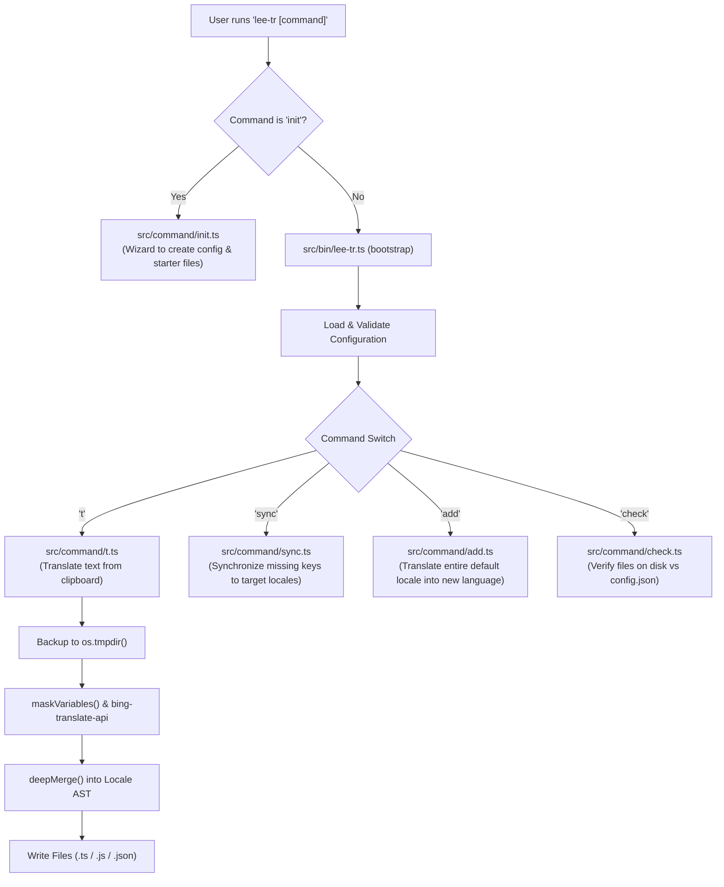

# Architecture & Commands Guide

This document describes the runtime architecture, command workflows, and lifecycle management of `lee-tr-cli`.

---

## 1. High-Level Architecture

The CLI acts as an automation bridge between the developer's clipboard, translation APIs (`bing-translate-api`), and the project's localization files on disk.



---

## 2. Configuration Resolution Order

For commands requiring an existing configuration (`t`, `add`, `check`, `sync`), the CLI resolves configuration in 3-tier precedence:

1. **Explicit Flag**: `--filePath=/path/to/custom-config.json`
2. **`package.json`**: `"lee-tr": { "configPath": "..." }`
3. **Default Path**: `lee-tr/config.json` (relative to current working directory)

### Configuration Schema (`IConfig`)
```json
{
  "type": "module",
  "defaultLocale": "en",
  "locales": [
    { "lang": "en", "file": "en.ts" },
    { "lang": "km", "file": "km.ts" }
  ],
  "localePath": "src/locales"
}
```

- **`type`**: `'module'` (ESM TypeScript `export default`), `'commonjs'` (`module.exports =`), or `'json'`.
- **`defaultLocale`**: Reference/source language code for translations.
- **`locales`**: Array of targets with language code and filename.
- **`localePath`**: Target directory relative to project root.

---

## 3. Command Workflows

### A. The `init` Command (`lee-tr init`)
Bootstraps a brand-new translation setup without needing an existing configuration.

- **Interactive Wizard**:
  - Prompts for format type (`module`, `json`, `commonjs`).
  - Prompts for directory path (default `src/locales`).
  - Prompts for default language code (default `en`).
  - Prompts for target language codes (e.g. `km, ja, fr`).
- **Non-Interactive Flags**: Supports `--yes`, `--type=...`, `--localePath=...`, `--defaultLocale=...`, `--locales=...`, and `--force`.
- **Generated Assets**:
  - Creates the specified locales directory.
  - Generates the starter reference file (e.g. `src/locales/en.ts`) with starter dictionary keys.
  - Generates target locale files initialized with `{}`.
  - Writes the validated `lee-tr/config.json`.

---

### B. The `sync` Command (`lee-tr sync [targetLocale]`)
Synchronizes missing keys from the primary locale (`defaultLocale`) to all secondary locales.

1. **Extraction & Flattening**:
   - Reads and flattens the reference locale file (`defaultLocale`).
2. **Missing Key Detection**:
   - Compares the flattened key paths against each target locale using `getValueByPath()`.
   - Identifies any missing or empty string values without modifying existing translations.
3. **Dry-Run Preview**:
   - `--dry-run` flag prints missing keys and exits without modifying files.
4. **Token-Safe Translation & Injection**:
   - Masks interpolation variables (`{userName}`, `{{count}}`) before sending to translation API.
   - Restores original variables post-translation.
   - Injects the translated values into target objects using `setValue()`.
   - Saves updated locale files to disk.

---

### C. The `t` Command (`lee-tr t [keys]`)
Translates clipboard content into all configured target languages and appends the new keys.

1. **Key Extraction**:
   - If `[keys]` is provided as an argument (e.g. `lee-tr t button.submit`), sanitize with `removeSpaceAndSpecialChar`.
   - If no key is provided, read the clipboard and convert the phrase into a camelCase key using `objectKey()`.
2. **Key Normalization**:
   - If the key is not in English (checked with `isEnglish()`), translate the key itself into English.
   - Enforce max character limit (`LIMIT_OF_TRANSLATE_KEYS = 25`).
3. **Backup / Snapshot**:
   - Read current locale files.
   - Store temporary snapshots in `os.tmpdir()/lee-tr-<lang>.json`.
4. **Translation & Merge**:
   - Fetch translation from `bing-translate-api` with variable protection.
   - Convert dot notation to nested objects (`textToNestedObject`).
   - Check if the key already exists (`hasKeyOrObject`). If so, log a warning.
   - Merge new keys using `deepMerge`.
5. **Persistence & Rollback**:
   - Save modified content back to each locale file.
   - If any write fails, invoke `cleanup(configJson, 'ROLLBACK')` to restore from tmp snapshots.

---

### D. The `add` Command (`lee-tr add [locale]`)
Bootstraps a brand-new target language file by translating an existing reference locale.

1. Validates that `[locale]` is supported in `LANGUAGE_CODES`.
2. Reads the primary locale file and flattens keys.
3. Batches and translates values recursively with concurrency limit.
4. Reconstructs nested structure via `unFlattenObject` and `deepMerge`.
5. Writes the new file and updates `lee-tr/config.json`.

---

### E. The `check` Command (`lee-tr check`)
Performs static integrity checks on localization files.

1. Scans the directory specified in `localePath`.
2. Compares physical files on disk against entries in `config.json`.
3. Reports missing configurations or orphaned locale files.

---

## 4. Signal Handling & Lifecycle Safety

The CLI registers hooks in `setupLifecycleHooks()` inside `src/bin/lee-tr.ts`:

- **`SIGINT` (Ctrl+C)**: Triggers `cleanup(configJson, 'SIGINT')` to ensure unfinished writes are restored from tmp snapshots before exiting.
- **`SIGTERM`**: Calls cleanup and exits cleanly.
- **`uncaughtException`**: Prints exception details and exits with code `1`.
